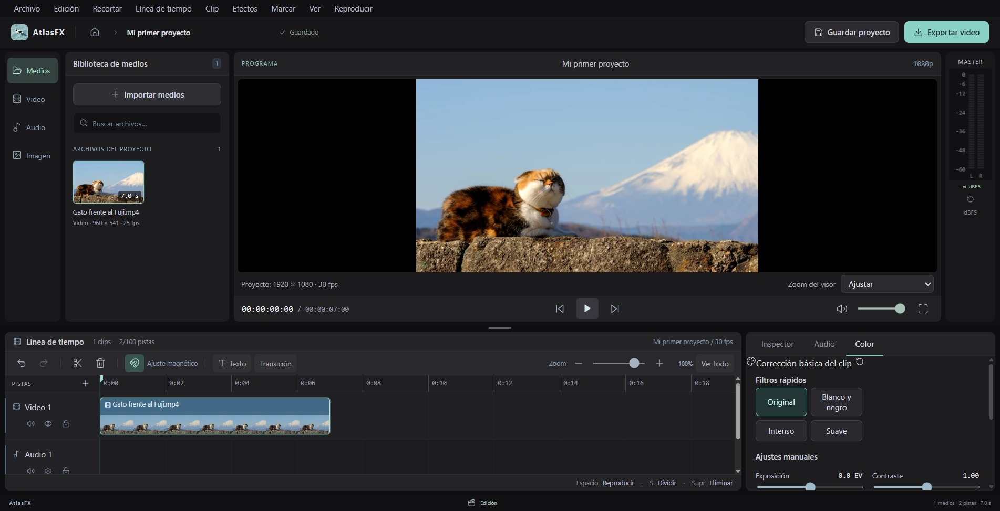
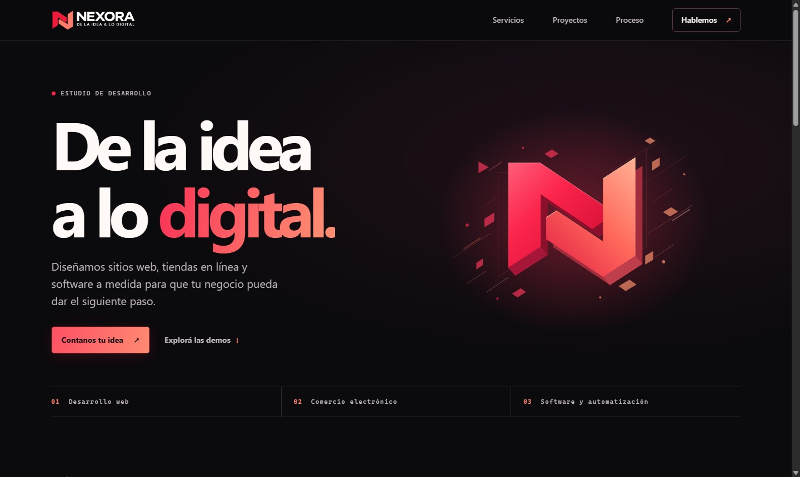
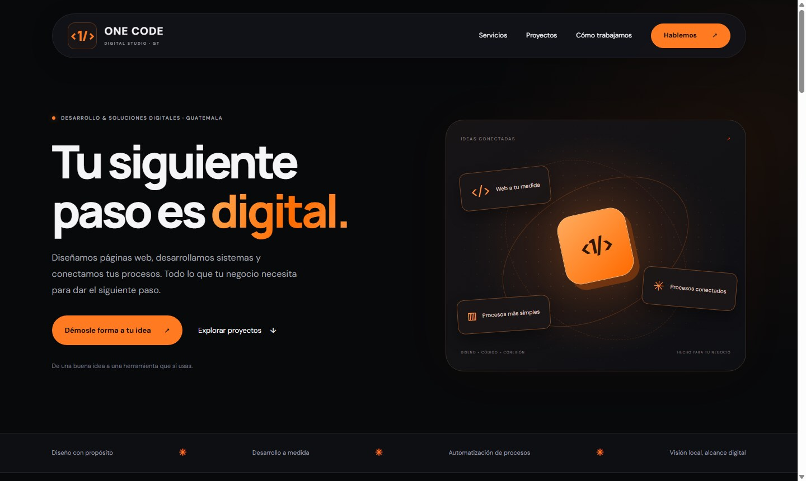

<h1 align="center">Santiago Morán</h1>

<strong>Desarrollador web y de software</strong>

  

<a href="https://santiagomoran709.github.io/portafolio-web/"><strong>Ver portafolio ↗</strong></a>

## Sobre mí

Desarrollo sitios web y aplicaciones con interfaces claras y fáciles de usar. Me enfoco en entender qué necesita resolver cada proyecto y convertirlo en una herramienta que simplifique el trabajo.

He trabajado en sitios para estudios de desarrollo y en herramientas como AtlasFX, un editor de video multipista para web y escritorio.

### Lenguajes y tecnologías

   <strong>HTML</strong> &nbsp; · &nbsp;
   <strong>CSS</strong> &nbsp; · &nbsp;
   <strong>JavaScript</strong> &nbsp; · &nbsp;
   <strong>TypeScript</strong> &nbsp; · &nbsp;
   <strong>Python</strong>

## Proyectos seleccionados

### AtlasFX

Editor de video multipista con biblioteca de medios, edición local e interfaz en español. [Probar el editor web ↗](https://santiagomoran709.github.io/portafolio-web/demos/atlasfx/index.html)

| Nexora | One Code |
| --- | --- |
|  |  |
| Sitio de un estudio de desarrollo con demos conceptuales. [Abrir Nexora ↗](https://santiagomoran709.github.io/nexora/) | Sitio de desarrollo web, sistemas y automatización en Guatemala. [Abrir One Code ↗](https://estudio-digital-gt-propuesta.mightyjam13.chatgpt.site/) |
